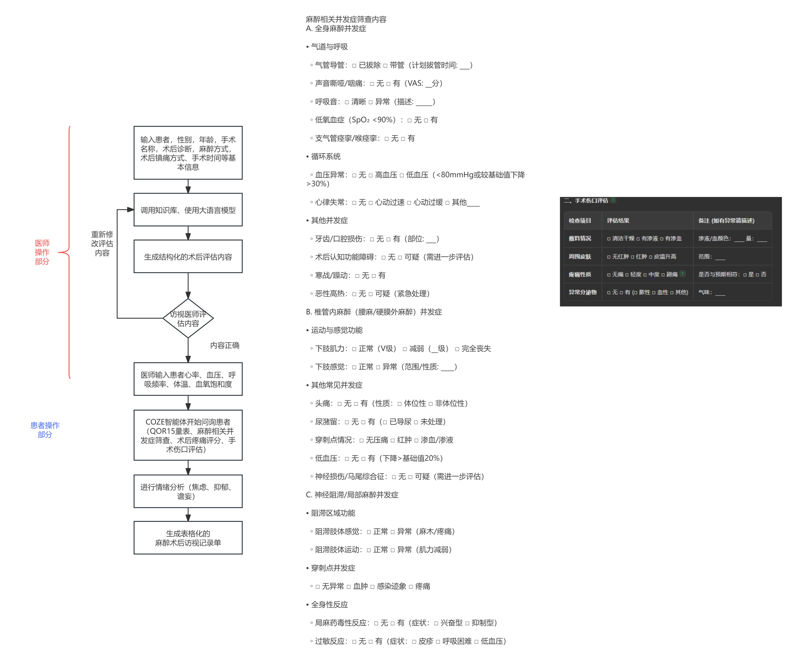
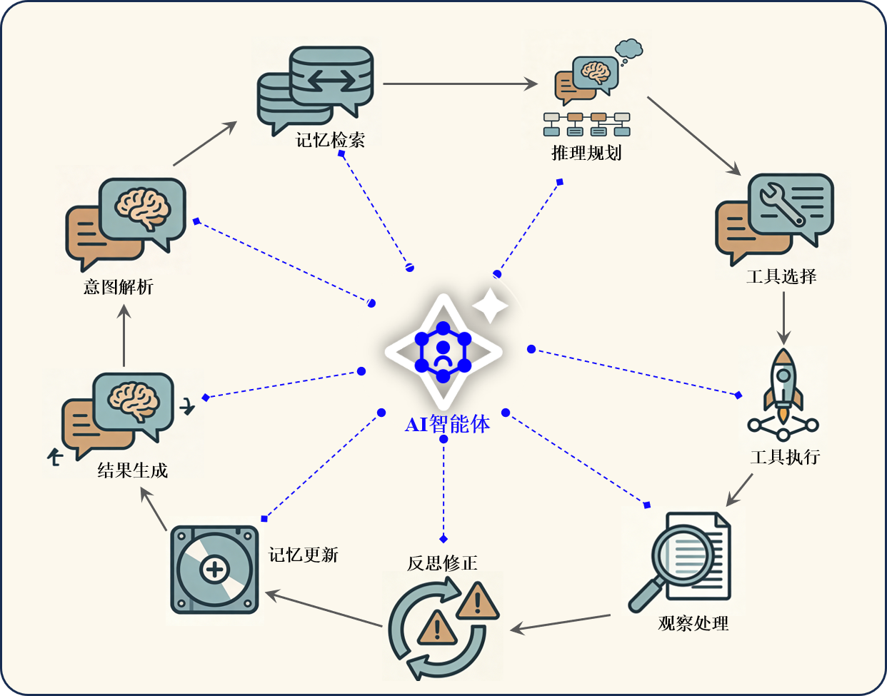
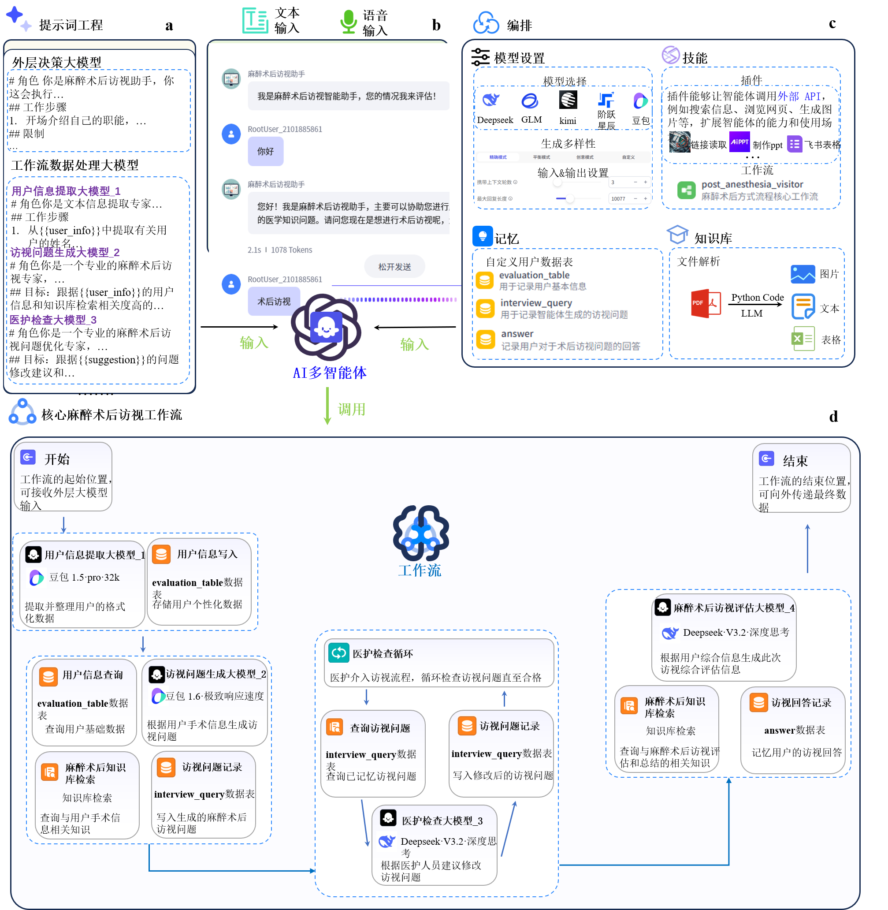
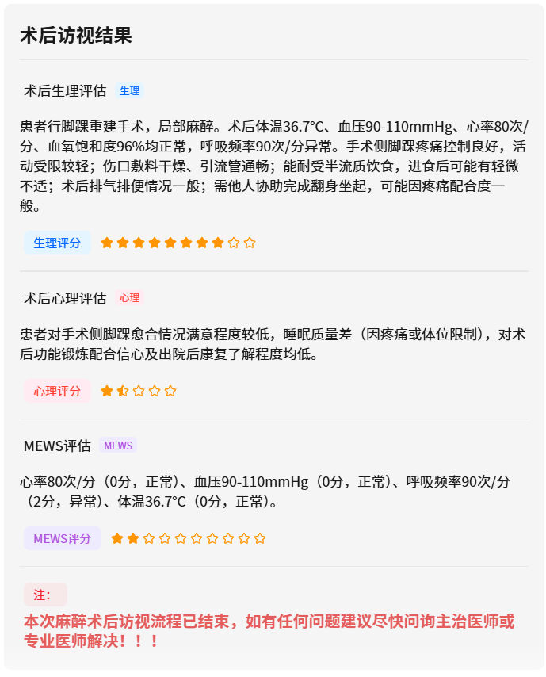

# 麻醉术后访视助手 · Post-Anesthesia Follow-up Agent

> 本地优先（Local-first）的麻醉术后结构化访视与医疗知识库 AI 智能体。
> 本项目从早期 COZE 多智能体工作流原型演进而来，当前为可本地部署的 FastAPI + Vue3 全栈应用，用于研究、教学与个人技术展示。

**⚠️ 免责声明：本项目不是临床验证或监管批准的医疗器械，不能替代医护人员的判断。所有报告均为草稿，必须由临床人员审核。演示请仅使用合成数据与完全脱敏截图。**

## 项目简介

面向术后 24 小时患者随访场景，将本地 Ollama 大模型、检索增强生成（RAG）、确定性随访状态机与 DOCX 报告生成整合为可部署的 Web 应用，实现：

- **患者信息采集** → **MEWS 早期预警评分** → **QoR-15 恢复质量评估** → **并发症筛查** → **伤口评估** → **结构化访视报告** 的完整闭环。

该场景的研究背景与多维度临床评价（150 例三组对照研究）详见 `docs/` 中的论文材料。

> **本仓库为项目展示版**：仅包含文档、架构图与效果截图，不包含可运行的源码。完整源码在私有仓库中维护，获取方式见下文「源码获取」。

## 界面与架构展示

| 本地系统流程 | AI 智能体循环 |
|---|---|
|  |  |

| COZE 多智能体原型架构 | 结构化访视报告（合成示例） |
|---|---|
|  |  |

> 注：智能体循环图与多智能体架构图来自研究阶段材料；运行截图中的患者信息均为合成示例数据。

## 核心特性

- **本地模型与知识库**：Ollama 对话 / Embedding 模型，本地 Chroma 向量库，BM25 混合检索 + 可选重排序，数据不出域。
- **多格式文档处理**：PDF / DOCX / TXT / Markdown / PPTX / XLSX / HTML；扫描版 PDF 支持离线 OCR（RapidOCR）。
- **受控工作流**：确定性状态机驱动分阶段随访——基础信息与 MEWS → 三轮 QoR-15 → 并发症筛查 → 伤口评估 → 结构化报告。
- **本地管理界面**：对话、知识库、患者档案、随访记录与设置，REST/SSE 双通道接口（对话增量流式推送）。
- **报告输出**：按会话生成可下载的 DOCX 访视报告草稿，供临床人员审核。

## 技术栈

| 层 | 技术 |
| --- | --- |
| 前端 | Vue 3、Vite、Vue Router、Pinia、Tailwind CSS |
| 后端 | Python、FastAPI、Pydantic、Uvicorn |
| 模型 | Ollama、LangChain |
| RAG | Chroma、rank-bm25、Sentence Transformers |
| 文档 | PyMuPDF、python-docx、python-pptx、openpyxl、RapidOCR |

## 源码获取

本仓库为**项目展示版**：只包含文档、架构图与效果截图，**不包含可运行的源码**。

- 完整源码（FastAPI 后端 + Vue3 前端 + 部署脚本）在**私有仓库**中维护。由于项目相关论文在投、专利在申请，源码暂不提供公开下载。
- 如需学术交流、合作或申请源码访问权限，请联系 **pillar_dl@163.com**，说明单位与用途，审核通过后可获得私有仓库的协作访问权限。

## 文档

完整的系统架构、模块设计、API 与部署说明见 [docs/GITHUB_PROJECT_DOCUMENTATION.md](docs/GITHUB_PROJECT_DOCUMENTATION.md)，研究阶段的功能说明见 [docs/README.legacy.zh-CN.md](docs/README.legacy.zh-CN.md)。技术栈：Python / FastAPI / Ollama / LangChain / Chroma / Vue 3 / Vite / Tailwind CSS。

## 隐私与安全

- 仓库不包含任何真实患者数据、医院内部资料、知识库原文、会话、报告、向量库、日志、`.env` 与模型权重。
- 首次公开前已按 `.gitignore` 执行人工审阅；如需自行部署，请同样遵守医疗数据合规要求。

## License

[MIT](LICENSE)

---

*[English README](README.en.md)*
