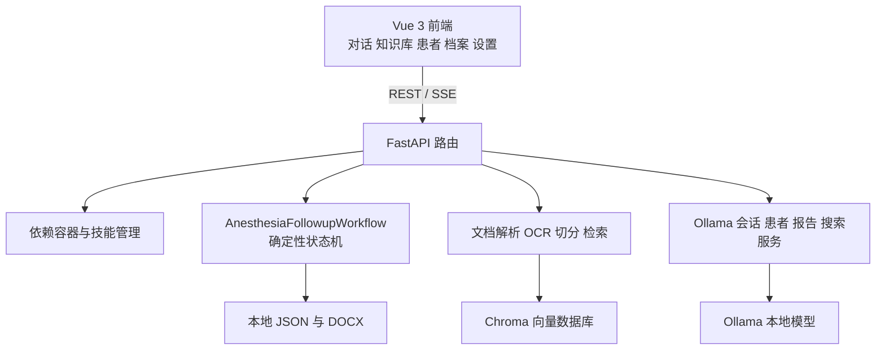
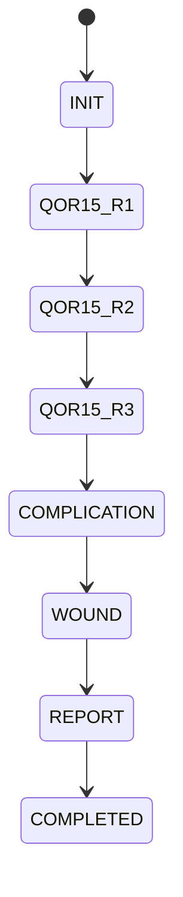

# 麻醉术后访视智能体项目技术文档

## 1 项目定位

本项目是一个本地优先的麻醉术后访视智能体原型。它由早期 COZE 平台工作流演进为可独立部署的前后端应用：在本机使用 Ollama 运行对话与向量模型，使用 RAG 支持本地知识库问答，并以确定性状态机约束麻醉术后访视的阶段顺序和报告生成。

项目既有的可行性报告、论文和技术文档用于定义临床问题、访视维度、评价设计与系统演进背景。本仓库展示软件实现，不应将研究设计、预期目标或原型能力表述为已经取得临床验证效果。

> 重要：本项目仅供研究、教学和技术展示。它不是经临床验证或监管批准的医疗器械，不能替代诊断、治疗、分诊、急救或任何医护人员的专业判断。所有评分、风险提示、对话与报告均须经有资质的临床人员复核。

## 2 核心能力

- **本地模型推理**：通过 Ollama 调用本地聊天模型与 Embedding 模型，默认配置为 `gemma4:e4b` 和 `nomic-embed-text`。
- **本地 RAG**：支持 PDF、DOCX、TXT、Markdown、PPTX、XLSX、HTML；扫描 PDF 使用离线 RapidOCR 回退；使用 Chroma、BM25 和可选重排序检索。
- **受控访视流程**：依次完成信息采集与 MEWS、三轮 QoR-15、麻醉相关并发症筛查、伤口评估和 DOCX 报告生成。
- **本地数据持久化**：患者、会话、工作流、文档清单、向量库与报告保留在 `backend/data`。
- **Web 操作界面**：Vue 3 前端提供对话、知识库、患者档案、随访记录和配置页面；流式聊天使用 SSE。

## 3 系统架构



| 层级 | 关键目录 | 说明 |
| --- | --- | --- |
| 前端 | `frontend/src` | Vue 3、Vue Router、Pinia、Tailwind CSS、Axios |
| API | `backend/app/api` | 聊天、配置、知识库、患者、会话、报告路由 |
| 核心 | `backend/app/core` | Pydantic 配置、依赖容器、YAML 技能管理 |
| 业务 | `backend/app/services` | Ollama、患者、会话、报告与联网搜索服务 |
| RAG | `backend/app/rag` | 文档解析、OCR、Embedding、向量库和检索器 |
| 工作流 | `backend/app/skills` | 技能 YAML 与麻醉术后访视状态机 |
| 数据 | `backend/data` | 仅运行时使用，含潜在敏感信息，不应上传 |

## 4 关键数据流

### 4.1 普通聊天与 RAG

1. 前端向 `POST /api/chat/stream` 提交消息、历史、技能 ID 和检索开关。
2. `SkillManager` 读取 YAML，应用该技能的提示词、工具权限和参数。
3. 当启用知识库时，检索器执行向量检索与 BM25 混合检索；联网搜索仅在启用且技能允许时进行。
4. 后端将系统提示、检索上下文和最近对话组装后交给 `OllamaService`。
5. 生成内容经 SSE 逐 token 返回；结束事件附带来源、会话 ID 和可能的报告下载 URL。

### 4.2 知识库处理

1. 用户上传文件，或将文件放到 `backend/data/knowledge_sources`。
2. `DocumentProcessor` 按格式提取文本；没有文本层的 PDF 使用本地 RapidOCR。
3. 内容按 `CHUNK_SIZE` 和 `CHUNK_OVERLAP` 切分。
4. `OllamaEmbedding` 生成向量，`VectorStore` 写入 Chroma。
5. `manifest.json` 记录索引元数据；后台单工作线程执行处理，任务接口提供进度。

### 4.3 麻醉术后访视工作流



| 阶段 | 内容 | 代码保障 |
| --- | --- | --- |
| `INIT` | 基础信息、生命体征、MEWS | 固定阶段提示和结构化字段提取 |
| `QOR15_R1/R2/R3` | QoR-15 分三轮采集 | 15 项齐全时确定性汇总 A、B 和总分 |
| `COMPLICATION` | 按麻醉方式的并发症筛查 | 状态边界限制跨阶段问题 |
| `WOUND` | VAS、渗液、红肿、皮温、感染 | 结构化字段提取 |
| `REPORT` | 汇总并生成 DOCX | `ReportService` 按会话生成文件 |

## 5 技术栈

| 分类 | 技术 |
| --- | --- |
| 前端 | Vue 3、Vite、Vue Router、Pinia、Tailwind CSS、Axios、marked |
| 后端 | Python、FastAPI、Uvicorn、Pydantic、Pydantic Settings |
| 模型服务 | Ollama、LangChain、langchain-ollama |
| 向量与检索 | Chroma、rank-bm25、FAISS 依赖、Sentence Transformers |
| 文档与 OCR | PyMuPDF、python-docx、python-pptx、openpyxl、RapidOCR |
| 报告 | python-docx |

## 6 安装与运行

### 6.1 前置条件

- Python 3.10+
- Node.js 18+
- 已安装并运行 Ollama
- 建议 16 GB 以上内存；模型大小和 GPU 决定实际资源需求

### 6.2 首次安装

```bash
ollama pull gemma4:e4b
ollama pull nomic-embed-text

cd backend
python -m venv venv
# Windows: venv\Scripts\activate
# macOS/Linux: source venv/bin/activate
pip install -r requirements.txt

cd ../frontend
npm ci
npm run build
cd ..
```

按需复制 `backend/.env.example` 为 `backend/.env` 后修改。不要提交该 `.env` 文件。

```powershell
Copy-Item backend/.env.example backend/.env
.\start.ps1
```

启动后访问 `http://localhost:8000`。脚本会检查 Ollama 与向量模型，并启动监听 8000 端口的 FastAPI 服务。

### 6.3 重要配置

| 变量 | 默认值 | 含义 |
| --- | --- | --- |
| `OLLAMA_BASE_URL` | `http://127.0.0.1:11434` | Ollama 地址 |
| `OLLAMA_MODEL` | `gemma4:e4b` | 对话模型 |
| `OLLAMA_EMBEDDING_MODEL` | `nomic-embed-text` | 向量模型 |
| `EMBEDDING_PROVIDER` | `ollama` | `ollama` 或 `huggingface` |
| `CHUNK_SIZE` / `CHUNK_OVERLAP` | `512` / `128` | RAG 切分参数 |
| `TOP_K` / `ENABLE_RERANK` | `5` / `true` | 检索参数 |
| `TEMPERATURE` / `MAX_TOKENS` | `0.3` / `2048` | 生成参数 |

发布前需统一 `backend/app/core/config.py`、`backend/.env.example` 和 `start.*` 中的默认对话模型名称。当前模板中的模型名与代码/脚本不一致，若不统一会导致新用户按模板配置后行为不同。

## 7 API 摘要

| 功能 | 路由 |
| --- | --- |
| 健康检查 | `GET /api/health`、`GET /api/health/warmup`、`GET /api/health/ollama` |
| 聊天 | `POST /api/chat`、`POST /api/chat/stream`、`GET /api/skills` |
| 配置 | `GET/POST /api/config` |
| 知识库 | `POST /api/knowledge/upload`、`GET /api/knowledge/local`、`POST /api/knowledge/process`、`GET /api/knowledge/tasks`、`GET/DELETE /api/knowledge` |
| 患者 | `GET/POST /api/patients`、`GET/PUT/DELETE /api/patients/{patient_id}` |
| 会话与报告 | `GET /api/sessions`、`GET/PUT/DELETE /api/sessions/{session_id}`、`GET /api/reports/{session_id}` |

运行后可访问 `/docs` 查看 FastAPI 自动生成的接口模型。流式聊天端点使用 SSE，典型事件包含 `token`、`done` 和 `error`。

## 8 隐私 安全 与 GitHub 发布

### 必须忽略的文件

下列内容可能包含个人健康信息、内部资料、密钥或可再生成产物，不能上传 GitHub：

- `backend/data/` 下的患者、会话、工作流、知识源、向量库与报告
- `backend/.env`、日志、调试响应 JSON
- `backend/venv/`、`frontend/node_modules/`、`frontend/dist/`
- 未明确获授权公开的临床指南、教材、医院制度、论文审稿材料和原始访视文本

建议的 `.gitignore`：

```gitignore
backend/venv/
frontend/node_modules/
frontend/dist/
backend/data/
!backend/data/.gitkeep
backend/.env
.env
*.log
backend/*_response*.json
backend/round*.json
backend/wf*.json
chat_payload.json
```

### 发布前检查

- [ ] 使用合成患者、合成对话和完全脱敏截图制作演示。
- [ ] 运行 `git status --ignored`，人工检查没有患者信息、医院资料、密钥或模型权重。
- [ ] 保留项目定位与临床复核声明，不把研究设计或原型输出宣传为临床效果。
- [ ] 统一模型配置并在干净环境完成一次依赖安装、前端构建和健康检查。
- [ ] 将 GitHub Topics 设为 `llm`、`ollama`、`fastapi`、`vue`、`rag`、`healthcare-ai`、`clinical-workflow`。
- [ ] 公开前收窄 CORS、关闭调试、禁止在不受控网络处理真实数据。

## 9 开发建议

1. 新 API 放在 `backend/app/api` 并在 `main.py` 注册；业务逻辑放在 `services`。
2. 修改技能流程时同时维护 YAML、状态机、报告字段和本技术文档；临床规则须经临床团队审阅。
3. 后续补充 `pytest` 测试状态迁移、结构化提取、RAG 边界和 API；用前端端到端测试验证最小闭环。
4. 将 JSON 文件存储抽象为持久化接口，并在真实研究前补齐认证、授权、审计、加密、受控 CORS 和数据留存策略。

## 10 已知限制

- 当前工作流包含基于自然语言的字段抽取，不能保证面对任意输入均达到临床级完整性。
- 当前为本地 JSON/文件系统存储，未具备多用户、审计、并发治理或生产级安全能力。
- 默认 CORS 允许所有来源，适合开发演示，不适合非受控网络中的敏感数据。
- 项目材料中的临床研究设计不构成对当前软件的临床验证或性能证明。
